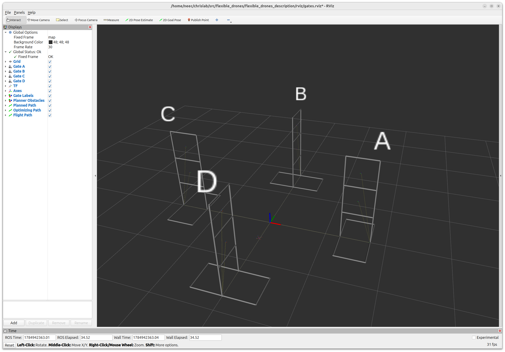
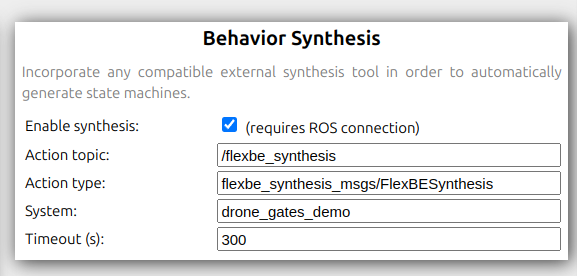
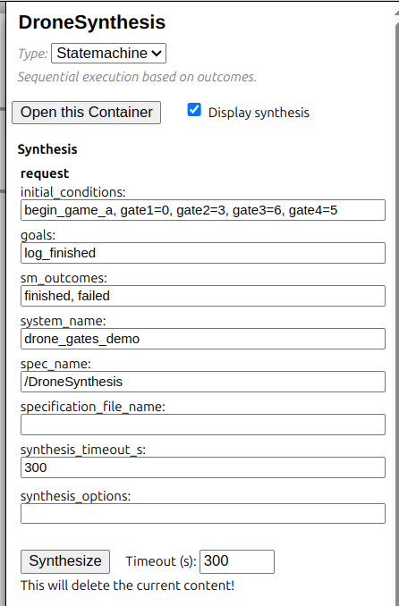

# Flexible-Drones Demonstration

This demonstration synthesizes multi-step aerial behaviors using the
portable [`flexible_drones`](https://github.com/CNURobotics/flexible_drones)
interfaces. Its high-level behavior is intended to work with a configured
Crazyflie, PiHawk/ArduCopter, or Gazebo drone without importing
vehicle-specific packages.

The first scenario plans and flies an out-and-back route through four gates.
It uses the common `flexible_drones_msgs` messages and
`flexible_drones_flexbe_states` interfaces. The only demo-local state converts
compact gate IDs into the TF frame convention used by the upstream
`gates_demo_sm.py` reference behavior.

See [the migration plan](DRONE_DEMO_PLAN.md) for the package layout and
safety model.

## Quick Start: Synthesis Only

Confirm the synthesis pipeline compiles and solves the four-gate route before
bringing up Gazebo, RViz, or the FlexBE WebUI. This needs only the synthesis
server and a request client — no simulator or drone bringup.

```bash
# Terminal 1 — synthesis server (default one-hot encoding)
ros2 launch drone_demo_flexbe_synthesis drones_gates.launch.py

# Terminal 2 — synthesis request (defaults to route A1 -> B2R -> D1 -> C2R -> home)
ros2 run drone_demo_flexbe_synthesis request_gates_flight
```

The default `drones_gates.launch.py` server uses the one-hot capability
encoding. To synthesize the same system with the enumerated encoding instead,
launch the alternative server in Terminal 1:

```bash
ros2 launch drone_demo_flexbe_synthesis drones_gates_enumerated.launch.py
```

Both launches use the system name `drone_gates_demo`, so the request command
and FlexBE configuration are unchanged. Run only one of the synthesis servers
at a time; their latest artifacts share the same output directory.

The server writes synthesis artifacts below
`~/.flexbe_synthesis/drone_gates_demo/drones_gates/`, including the generated
state-machine graph, whether or not any simulator is running. Override
`gate1`, `gate2`, `gate3`, or `gate4` through the standard request client ROS
parameters to synthesize a different route (see
[Gate values](#gate-values) below).

Once this succeeds, continue to [GazeboSim Setup](#gazebosim-setup) to fly the
synthesized behavior.

## GazeboSim Setup (Small Course, Crazyflie)

Start with Gazebo before connecting hardware: it exercises the same arm,
takeoff, land, go-to, trajectory-upload, and trajectory-execution interfaces
used by the synthesis demo.

These directions bring up the small four-gate course (3/4" PVC, gates
centered at +/-1.5 m) with a simulated Crazyflie — the easiest course/vehicle
combination to start with. For the larger BAG course with simulated
PiHawks, see [BAG Course with PiHawks](#bag-course-with-pihawks) below,
which follows the same pattern with different course/deployment arguments
and different `drone_synthesis` behavior parameters.

The commands below use the CNU example deployment package for its roster and
deployment setup. Replace `chris_serc_deployment` with a package that provides
your own equivalent configuration when using another deployment. Skip any clone
that is already present in the workspace.

```bash
cd "$WORKSPACE_ROOT/src"
git clone https://github.com/CNURobotics/flexible_drones.git
vcs import < flexible_drones/flexible_drones.repos
git clone https://github.com/CNURobotics/chris_serc_deployment.git

cd "$WORKSPACE_ROOT"
rosdep install --from-paths src --ignore-src -r -y
colcon build --symlink-install
source install/setup.bash
```

In separate sourced terminals, launch a Gazebo world, spawn the four-gate
course into it, then bring up one simulated drone. The `bringup_drones` launch
projects the selected deployment onto the Gazebo manager, so its
backend-independent interfaces are the same ones used by the Crazyflie and
PiHawk backends.

```bash
# Terminal 1: Gazebo world
ros2 launch flexible_drones_gazebo bringup_lighthouse.launch.py
```

```bash
# Terminal 2: spawn the small four-gate course (gates A/B/C/D) into Gazebo
ros2 launch flexible_drones_gazebo spawn_drone_course.launch.py \
  with_markers:=false
```

This is the small course (3/4" PVC, 0.5 m segments, gates centered at
+/-1.5 m) — not `spawn_serc_course.launch.py`, which spawns the larger BAG
course (1" PVC, 1.0 m segments, gates centered at +/-2.5 m; see
[BAG Course with PiHawks](#bag-course-with-pihawks) below). Both use the
same gate IDs A/B/C/D this demo assumes — see
[Gate values](#gate-values) below. Without this
step the drone has no gates to fly through.

`with_markers:=false` suppresses this launch's own TF/robot_state_publisher/
gate-label nodes, since Terminal 4 below (`rviz_drone_course.launch.py`)
publishes its own independent copy of the same TF and `/gate_labels` data —
running both would mean two unsynchronized publishers on the same topic.

```bash
# Terminal 3: one simulated drone and its standard action/service interfaces
ros2 launch flexible_drones_gazebo bringup_drones.launch.py \
  deployment_package:=chris_serc_deployment \
  deployment:=crazyflies \
  fliers:="[cf1]"
```

`flexible_drones_gazebo` is a kinematic visualization and high-level-behavior
simulator, not a physics or controller-tuning environment.

Visualize the gate course in RViz — this publishes its own TF and
gate-label data (independent of Terminal 2) and opens RViz with the
`gates.rviz` config. Pass the matching `course_config` so the gate markers
land at the same positions as the small course spawned above, not the
default (SERC BAG) layout. This step is required, not optional: it's the
only source of the `/gate_A_description` .. `/gate_D_description` topics
the trajectory planner below uses for gate-obstacle avoidance (Terminal 2
runs with `with_markers:=false`), and it is where you inspect the planned
trajectory before execution later.

```bash
# Terminal 4: visualize the gate course in RViz
ros2 launch flexible_drones_description rviz_drone_course.launch.py \
  course_config:=small_gates.yaml
```



```bash
# Terminal 5: trajectory planner (provides /plan_trajectory and /set_trajectory_bounds)
ros2 launch flexible_drones_tools plan_trajectory_with_gates.launch.py \
  obstacle_safety_margin:=0.10
```

This node backs the `GetTrajectoryState`/`SetTrajectoryBoundsState` capabilities
used by every route segment; without it the synthesized behavior times out
waiting for `/plan_trajectory` and `/set_trajectory_bounds`. It treats the
four gate URDF topics published by Terminal 4 as planning obstacles, and this
is always on for all four gates regardless of route — there is no way to
disable a gate's default obstacle for a particular segment.

`obstacle_safety_margin` inflates each gate's thin PVC pipe collision radius
by a fixed amount; its default (`0.381`) is tuned for the larger BAG course's
1" pipe and PiHawk-scale clearances. On this small course (3/4" PVC), that
default inflates a gate's own pipe enough that the gate's own target point —
which the drone must fly through by design — ends up inside its own obstacle,
and every segment's plan request fails with `Boundary obstacle precheck
failed`. `0.10` keeps a safety buffer around the pipe without blocking the
gate opening it belongs to. Each route segment's own start/target gate relies
on this smaller margin to be flyable; the synthesized behavior separately
sends larger avoidance cylinders (`gate_radius`, `GateObstacleAvoidanceState`)
for the *other* three gates before planning each segment, both to keep the
drone away from gates it isn't flying through and because those single
cylinders replace many small per-gate pipe obstacles in the optimizer, which
noticeably speeds up planning.

## BAG Course with PiHawks

The larger BAG course (1" PVC, 1.0 m segments, gates centered at +/-2.5 m)
with simulated PiHawks follows the same five-terminal pattern as the small
course above, but uses the SERC drone-lab world as well as different
course/deployment arguments. See the small-course section above for what each
terminal does and why; only the differences are called out here.

```bash
# Terminal 1: SERC drone-lab Gazebo world
ros2 launch flexible_drones_gazebo bringup_drone_lab.launch.py
```

```bash
# Terminal 2: spawn the BAG four-gate course into Gazebo
ros2 launch flexible_drones_gazebo spawn_serc_course.launch.py \
  with_markers:=false
```

```bash
# Terminal 3: one simulated PiHawk and its standard action/service interfaces
ros2 launch flexible_drones_gazebo bringup_drones.launch.py \
  deployment_package:=chris_serc_deployment \
  deployment:=pihawks \
  fliers:="[px1]"
```

```bash
# Terminal 4: visualize the gate course in RViz
ros2 launch flexible_drones_description rviz_drone_course.launch.py \
  course_config:=serc_bag.yaml
```

```bash
# Terminal 5: trajectory planner
ros2 launch flexible_drones_tools plan_trajectory_with_gates.launch.py use_cache:=true
```

Terminal 5 omits the `obstacle_safety_margin` override used for the small
course: the default (`0.381`) is already tuned for this course's thicker 1"
PVC and PiHawk-scale clearances.

Continue to [Synthesize and Fly](#synthesize-and-fly-the-four-gate-behavior)
below, but set these `drone_synthesis` behavior parameters instead of the
small-course values in step 1:

| Parameter        | Small course (Crazyflie) | BAG course (PiHawk) |
| ----------------- | ------------------------ | -------------------- |
| `drone_name`      | `cf1`                     | `px1`                 |
| `gate_radius`     | `0.9`                     | `0.9` (unchanged)     |
| `gate_distance`   | `1.5`                     | `2.5`                 |

`gate_radius` (the avoidance cylinder around gates not on the current route
segment) doesn't need to change between courses — it was already sized for
the larger course's gate spacing, so it comfortably clears the small
course's tighter spacing too. `gate_distance` must match each course's actual
gate *center* distance, which is **not** the `pose.x`/`pose.y` value in
`flexible_drones_description/config/small_gates.yaml`/`serc_bag.yaml`
(`1.75`/`3.0`) — those poses place the gate frame's far pipe edge, offset
from the center by `pipe_length / 2` (`0.25` m small course, `0.5` m BAG),
so the actual centers are `1.5` m and `2.5` m. Using the pose values directly
would put the avoidance cylinders that much off-center; the current 0.9 m
avoidance radius happens to tolerate that error, but the values above are
the correct ones.

## Synthesize and Fly the Four-Gate Behavior

Keep the Gazebo, gate, `cf1`, RViz, and planner terminals running, then use
two more sourced terminals for the synthesis server and the FlexBE
WebUI/onboard executor.

```bash
# Terminal 6: synthesis server (default one-hot encoding)
ros2 launch drone_demo_flexbe_synthesis drones_gates.launch.py
```

To use the enumerated encoding instead, replace the Terminal 6 command with
`ros2 launch drone_demo_flexbe_synthesis drones_gates_enumerated.launch.py`.
The system name remains `drone_gates_demo` for either encoding.

```bash
# Terminal 7: FlexBE WebUI and onboard executor
ros2 launch flexbe_webui flexbe_full.launch.py
```

Trigger synthesis from the WebUI rather than the command line, so the
generated behavior loads directly into the editor:

0. FlexBE Configuration

   In the **Configuration** tab, set the system name to `drone_gates_demo`
   to match the synthesis server above.

   

1. Load the `drone_synthesis` behavior from `drone_demo_flexbe_behaviors` on
   the Dashboard, and set its `drone_name`, `gate_radius`, and
   `gate_distance` parameters to match whichever course and deployment you
   brought up (small course/Crazyflie defaults shown; see the
   [BAG Course with PiHawks](#bag-course-with-pihawks) table above for the
   BAG/PiHawk values). It provides the shared flight userdata and a
   temporary `DroneSynthesis` container that synthesis replaces.

2. Open the `DroneSynthesis` container.
   - Tick **Display Synthesis**.
   - Set **Initial Conditions** to `begin_game_a, gate1=0, gate2=11, gate3=6, gate4=13`
     — the default route `A1 -> B2R -> D1 -> C2R -> home` (see
     [Gate values](#gate-values) below to choose another route).
   - Set **Goals** to `log_finished`.

   

   The screenshot above predates the `B2R`/`C2R` route change (it shows
   `gate2=3, gate4=5`) but the field layout is otherwise identical — use the
   `gate2=11, gate4=13` values from the Initial Conditions line above.

3. Click **Synthesize** to populate the container with the generated
   behavior. This can take a few minutes — the pipeline's default
   `synthesis_timeout_s` (`pipeline/processes_data.yaml`) allows 300 s.

4. Open the container to inspect the synthesized state machine.

5. Save the behavior and switch to **Runtime Control** to execute and inspect
   the planned trajectory in RViz and approve the operator decision before
   the behavior uploads, arms, and flies the drone.

The server also writes synthesis artifacts below
`~/.flexbe_synthesis/drone_gates_demo/drones_gates/`, including the
generated state-machine graph.

### Optional: skip synthesis with the pre-synthesized result

`drone_synthesis_one_hot` is the already-synthesized one-hot behavior for the default
route (`A1 -> B2R -> D1 -> C2R -> home`) on the small course, saved from a
prior synthesis run. To skip the wait, load `drone_synthesis_one_hot` instead
of `drone_synthesis` on the Dashboard (step 1), set `drone_name`, and go
straight to step 5 — no Configuration tab, Display Synthesis, or Synthesize
click needed. Still requires Terminals 1-5 (Gazebo, gate, drone, RViz,
planner) running. This shortcut isn't available for the BAG course — it
would need its own synthesis run with BAG-specific behavior parameters.

### Gate values

The route is parameterized by the `gate1`-`gate4` Initial Conditions above,
while the drone namespace, gate avoidance radius, and course gate distance
are `drone_synthesis` behavior parameters (`drone_name`, `gate_radius`,
`gate_distance`).
Synthesized Flexible Drones states receive it directly as
`namespace=self.drone_name`. Gate values `0` through `7` map to `A1`, `A2`,
`B1`, `B2`, `C1`, `C2`, `D1`, and `D2` respectively;
values `8` through `15` select the
corresponding reverse gate crossing (`A1R` through `D2R`).

After trajectory execution begins, an execution failure is logged and follows
the recovery-landing path. The behavior disarms only after a successful landing.
Takeoff and the move-to-route-start step retain operator confirmation paths so
the operator can assess a reported failure before continuing.

## Hardware Directions

Keep vehicle-specific installation, calibration, safety, and bringup procedures
in their owning repositories. After validating a Gazebo run, follow the
appropriate official guide, bring up the selected drone, and use the same
high-level demo configuration with that drone namespace:

- [Flexible Drones workspace and dependency setup](https://github.com/CNURobotics/flexible_drones/blob/alpha/README.md)
- [Gazebo simulation details](https://github.com/CNURobotics/flexible_drones_gazebo/blob/alpha/README.md)
- [Crazyflie hardware bringup](https://github.com/CNURobotics/flexible_drones_crazyflie/blob/alpha/README.md)
- [PiHawk/ArduCopter hardware bringup](https://github.com/CNURobotics/flexible_drones_arducopter/blob/alpha/README.md)
- [Reusable FlexBE states and example behaviors](https://github.com/CNURobotics/flexible_drones_flexbe/blob/alpha/README.md)
