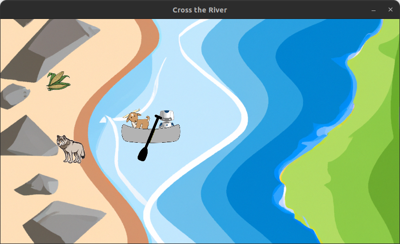
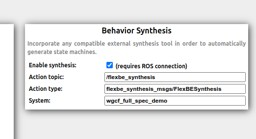
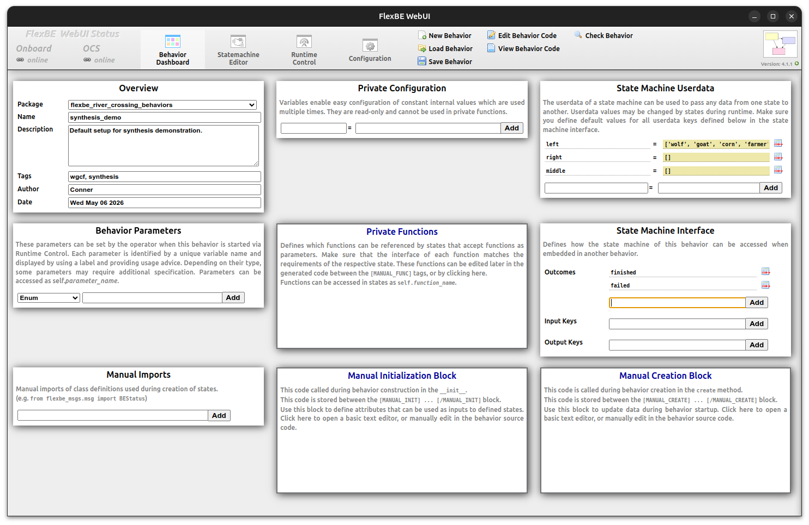
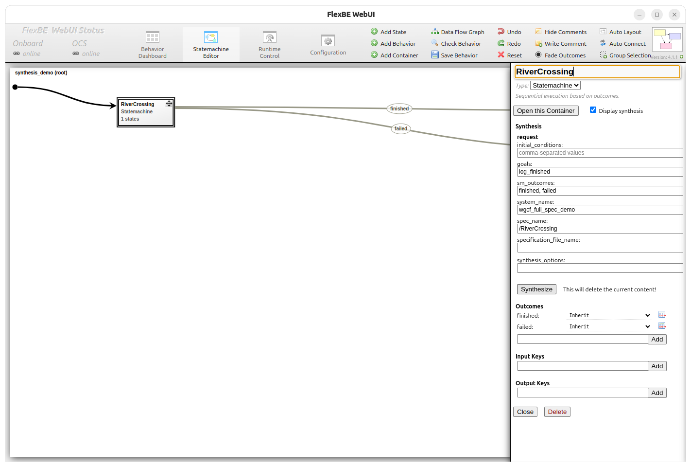
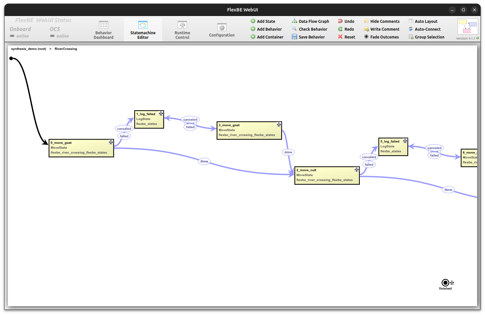
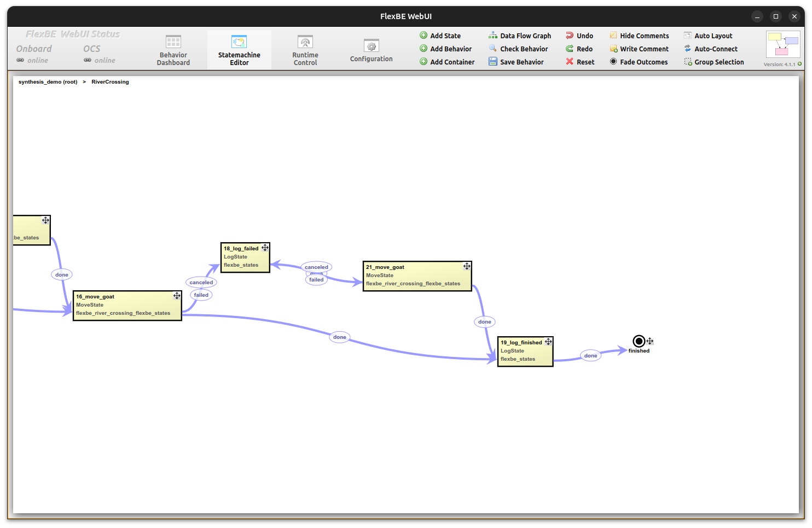
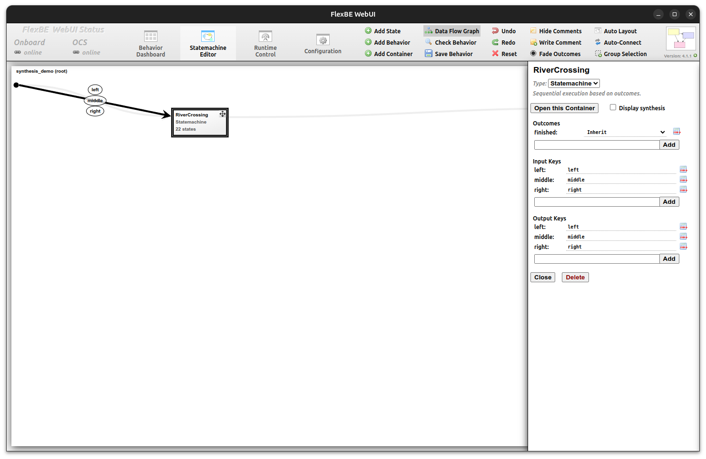
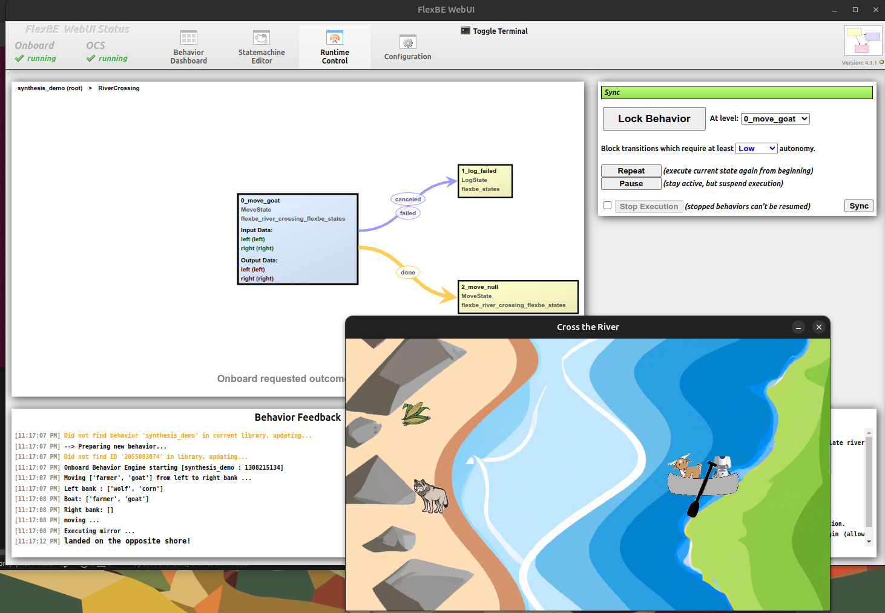
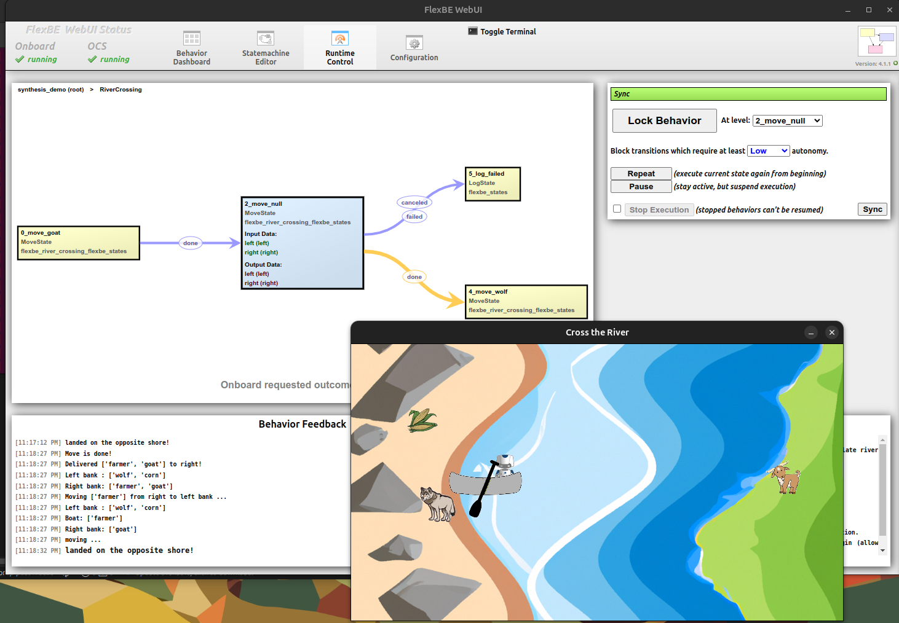
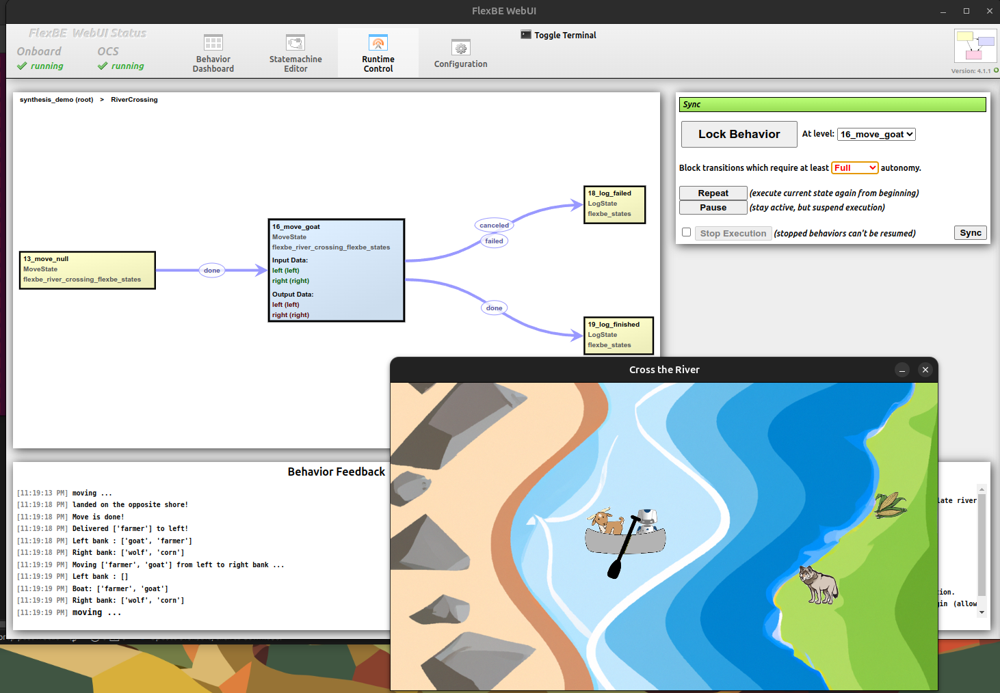

# River-Crossing Demonstration

This demonstration presents synthesis and execution of a
[FlexBE](https://github.com/FlexBE) Hierarchical Finite State Machine (HFSM) controller
that solves the classic Wolf-Goat-Corn-Farmer (WGCF) river-crossing puzzle.
It provides seven runnable demo modes spanning two puzzle variants and four specification styles,
serving as a hands-on introduction to correct-by-construction behavioral synthesis using GR(1) LTL.

These demonstrations are described in:

  * D. C. Conner, J. Luzier, E. R. Faith, W. J. Doyle, A. B. Kooiker, A. J. Farney, and I. G. Conner, "Capability-based robot controller synthesis," in Proc. 2026 IEEE Int. Conf. Electro/Information Technology (EIT), La Crosse, WI, USA, May 21–23, 2026, to be published.

## The Puzzle

In the WGCF variant a robotic farmer must carry a wolf, a goat, and a basket of corn
across a river:



The small boat carries one item at a time in addition to the farmer.
If the wolf and goat are left alone, the wolf eats the goat.
If the goat and corn are left alone, the goat eats the corn.
The synthesized controller guarantees safe passage of all items while reacting to
intermittent failures (e.g., a crossing attempt canceled due to weather).
The reactive strategy retries as many times as needed to achieve its goal.

Behavior design is a complex process requiring extensive design, development, and testing.
Behavioral synthesis shifts the burden from designing, implementing, and testing the proper
controller to defining correct logical specifications.
The benefit is that logical specifications allow formal verification and model checking from
the outset and clearly document the system requirements.

### Two-Rivers Extension

The two-rivers variant places three banks (left, middle, right) connected by two boats.
This extension demonstrates:

- Integer-valued position variables (`0`/`1`/`2` for left/middle/right) instead of per-bank booleans
- A two-boat `MoveState2R` FlexBE state with independent position and passenger tracking per boat
- Capability-based specification over a larger alphabet of move actions

## Setup

We assume that you have set up the `flexbe_synthesis` and FlexBE system as described in the top-level [`README`](../README.md).

To exclude this demonstration from the workspace build, place a `COLCON_IGNORE` file in the
`river_crossing/` folder.

Install `pygame` for the visualization:

```bash
sudo apt install python3-pygame
```

Alternatively, install it with `pip3 install pygame`.

```bash
colcon build --symlink-install --packages-up-to flexbe_river_crossing
source install/setup.bash
```


## Demo Modes

Seven modes are provided, each pairing a synthesis scenario (WGCF or Two Rivers) with a
specification style and pipeline variant.
See [`flexbe_river_crossing_synthesis/README.md`](flexbe_river_crossing_synthesis/README.md) for the
full launch/request pairing table and variation descriptions.

As a quick-start test using the full WGCF spec:

```bash
# Terminal 1 — synthesis server
ros2 launch flexbe_river_crossing_synthesis wgcf_synthesis.launch.py

# Terminal 2 — synthesis request
ros2 run flexbe_river_crossing_synthesis request_wgcf_full_spec
```

This will demonstrate that the synthesis pipeline is executing properly with Slugs.

Replace the launch file and request client with the matching pair from the table for
other modes (`two_rivers`, `wgcf_capabilities`, `two_rivers_parsed`, etc.).

### Visualization

```bash
# Single-river modes
ros2 run flexbe_river_crossing_visualization river_crossing

# Two-rivers modes
ros2 run flexbe_river_crossing_visualization river_crossing --two-rivers
```

### Starting FlexBE

```bash
ros2 launch flexbe_webui flexbe_full.launch.py
```

Or launch the onboard engine and OCS separately:

```bash
ros2 launch flexbe_onboard behavior_onboard.launch.py
ros2 launch flexbe_webui flexbe_ocs.launch.py headless:=true
ros2 run flexbe_webui webui_client
```

You may load the hand-crafted `wgcf_demo` behavior from `flexbe_river_crossing_behaviors`
to validate the basic FlexBE setup before running synthesis.

> For the hand-crafted demo, set autonomy to `High` so transitions occur automatically.

## Synthesizing and Running a Behavior


This section describes the basic demonstration using a hand-written
specification in [`specs/wgcf.yaml`](flexbe_river_crossing_synthesis/specs/wgcf.yaml).

The [Synthesis README](flexbe_river_crossing_synthesis/README.md) describes several other scenarios and the capability-based specification demonstrations.

Start the visualization, FlexBE stack, and synthesis server as shown in
[Demo Modes](#demo-modes) and [Starting FlexBE](#starting-flexbe) above, then follow
the steps below.

0. FlexBE Configuration

   The following update must be made in the FlexBE WebUI configuration tab:

   

   For this, change the system name from `system_wide` to `wgcf_full_spec_demo`.


1. Load the `synthesis_demo` behavior from `flexbe_river_crossing_behaviors`.
   This state machine has a single container with a temporary `LogState`.
   This will be replaced by the synthesized state machine.

   Or, create a **New Behavior** on the FlexBE Dashboard.
   - Set the `Behavior Name`, `Description`, and `Author`.
   - Add input keys `left` and `right` (plus `middle` for two-rivers) in the
     state machine interface.
   - Set `State Machine Userdata`:
     - `left = ['wolf', 'goat', 'corn', 'farmer']`
     - `right = []`
     - `middle = []`  *(two-rivers only)*

   

    Add a `StateMachine` container and connect it as the initial state; wire its outputs.

2. Open the StateMachine container
   - Tick **Display Synthesis**.  Set **Goals** to `log_finished`.
     Leave **Initial Conditions** empty — all modes encode their starting state
     internally (the full-spec YAMLs in `ENV_INIT`; the capability
     pipeline auto-generates and consumes the internal `begin_game` startup
     pseudo-capability).  Do not add `begin_game` to the request or map it to a
     FlexBE state.

   

3. Hit **Synthesize** to populate the container.

   A synthesis request replaces the current container contents.

4. Open the container to inspect the synthesized state machine.

   

   - Use `Shift + Left-click Drag` to pan; `Shift + Space` to reset the view.
   - The `Home` and `End` keys move between the state machine extents. (`Ctrl + Home/End` and `Shift + Home/End` also work.)
   - Use `Ctrl + 0` to fit the full state machine to the editor window. This view is read-only. Click the image to return to regular edit mode, centered on the click location.

   

   - Add input/output key variables `left` and `right` (and `middle`) to the
     container after synthesis. Synthesis resets these values.

   

   - Save the behavior.

5. Execute from the **Runtime Control** panel.
   - With the visualization running you will see the animated river crossing.
   - Use `cancel` or `fail` outcomes to simulate a crossing failure; the reactive
     controller retries as needed to achieve its goal.

   

   Synthesized behaviors use `Low` autonomy per transition by default; set runtime autonomy to `High` or `Full` for transitions to occur automatically without operator confirmation.
   Click `Done` to transition to the next phase when prompted at the UI.

   

   Changing to `Full` autonomy will execute the entire behavior autonomously.

   

   The per-transition autonomy permission levels can be adjusted post-synthesis in the state editor if desired.


## Related Publications

Please cite the following when using this demonstration:

  * D. C. Conner, J. Luzier, E. R. Faith, W. J. Doyle, A. B. Kooiker, A. J. Farney, and I. G. Conner, "Capability-based robot controller synthesis," in Proc. 2026 IEEE Int. Conf. Electro/Information Technology (EIT), La Crosse, WI, USA, May 21–23, 2026, to be published.

This synthesis work builds on:

  * J. Luzier and D. C. Conner, "Solving the Farmer's Dilemma with FlexBE Using GR(1) Synthesis," SoutheastCon 2024, Atlanta, GA, USA, 2024, pp. 1189–1196, doi: [10.1109/SoutheastCon52093.2024.10500189](https://doi.org/10.1109/SoutheastCon52093.2024.10500189).

  * J. W. M. Hayhurst and D. C. Conner, ["Towards Capability-Based Synthesis of Executable Robot Behaviors,"](http://dx.doi.org/10.1109/SECON.2018.8479047) IEEE SoutheastCon 2018, St. Petersburg, FL, USA.

  * S. Maniatopoulos, P. Schillinger, V. Pong, D. C. Conner and H. Kress-Gazit, ["Reactive high-level behavior synthesis for an Atlas humanoid robot,"](http://dx.doi.org/10.1109/ICRA.2016.7487613) ICRA 2016, Stockholm, Sweden.

  * R. Ehlers and V. Raman, [Slugs: Extensible GR(1) Synthesis](https://doi.org/10.1007/978-3-319-41540-6_19), CAV 2016.

Please cite the following when using FlexBE:

  * J. Zutell, D. C. Conner and P. Schillinger, ["ROS 2-Based Flexible Behavior Engine for Flexible Navigation,"](http://dx.doi.org/10.1109/SoutheastCon48659.2022.9764047) IEEE SouthEastCon, April 2022.

  * P. Schillinger, S. Kohlbrecher, and O. von Stryk, ["Human-Robot Collaborative High-Level Control with Application to Rescue Robotics,"](http://dx.doi.org/10.1109/ICRA.2016.7487442) ICRA 2016.
