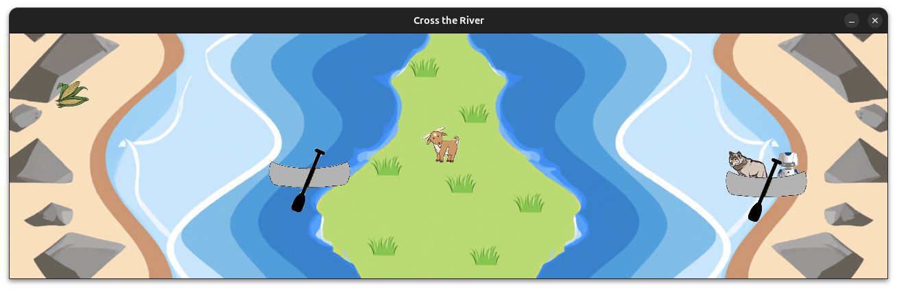

# flexbe_river_crossing_synthesis

Launch files, pipeline configurations, GR(1) specifications, and capability definitions
for the river-crossing synthesis demonstration.

For setup, build instructions, and step-by-step demo execution, see the
[river-crossing README](../README.md).

---

## Demo Modes

Seven modes are provided across two scenarios (WGCF and Two Rivers) and four
specification styles (full spec, integer-variable full spec, capabilities, capabilities
parsed).  Each mode stores its synthesis outputs in a `system_name`-keyed subdirectory
of `synthesis_home` so runs never overwrite each other.

During pytest runs, the demo-pair tests prepend `test_<system_name>` to the normal
synthesis home before launching each child process. This keeps parallel `pytest-xdist`
workers from sharing `workspace_defn.yaml` or other preprocessing artifacts while
still preserving overnight outputs for inspection. For example, with the default
home, the WGCF full-spec test writes under
`~/.flexbe_synthesis/test_wgcf_full_spec_demo/wgcf_full_spec_demo/`. Set
`FLEXBE_SYNTHESIS_HOME` to redirect the collection root.

### Request client vs. FlexBE WebUI

Two ways to trigger synthesis once the server is running:

**Request client** — `ros2 run flexbe_river_crossing_synthesis <client>` sends the
`FlexBESynthesis` action request from the command line.  The server synthesizes the
behavior and writes the generated Python state machine to `synthesis_home/<system_name>/`.
Use this for quick testing or scripted pipelines without starting the full FlexBE stack.

**FlexBE WebUI** — In the FlexBE WebUI **Configuration** tab, set the synthesis action
topic to `/flexbe_synthesis` (type `flexbe_synthesis_msgs/FlexBESynthesis`), then
trigger synthesis from the UI.  After synthesis the behavior is loaded into the behavior
editor.  Because synthesis resets input/output keys, you must re-add `left` and `right`
(and `middle` for two-river modes) to the container and set userdata:

```
left = ['wolf', 'goat', 'corn', 'farmer']
right = []
middle = []   # two-rivers modes only
```

### `spec_name` vs `spec_path` — two independent roles

These two parameters are **intentionally decoupled** and serve entirely different purposes:

- **`spec_path`** (server-side, set in the launch file) — the filesystem path to the YAML file
  containing the GR(1) constraints that the synthesizer reads.  This determines *what is
  synthesized* and is fixed at server launch time.

- **`spec_name`** (request-side, sent by the request client) — a label used to name the output
  subdirectory (`<synthesis_home>/<system_name>/<spec_name>/`) and Mealy-graph files.  It
  determines *where synthesis results are written*, not which spec is run.

The `two_rivers_parsed` mode illustrates this: `two_rivers_parsed.launch.py` sets `spec_path`
to `two_rivers_parsed.yaml`, but the request sends `spec_name: "two_rivers"` to match the
`spec_name:` field declared inside that file.  Because `system_name` differs (`two_rivers_parsed`
vs `two_rivers`), the two modes write to separate output directories and never collide.

> The spec loader cross-checks the `spec_name:` field inside the loaded YAML against the
> requested `spec_name` and logs a warning on mismatch, but this is non-fatal — `spec_path`
> always controls which file is read.

---

### WGCF (Wolf-Goat-Corn-Farmer)

The classic river-crossing puzzle: move wolf, goat, corn, and farmer across a single
river without leaving incompatible pairs unattended (wolf+goat or goat+corn).  Boolean
position variables encode which bank each character is on (`false` = left, `true` = right).

#### Full spec

All five GR(1) sections are hand-written in `specs/wgcf.yaml`.

- One boolean variable per character; one action variable per move
- `SYS_TRANS` encodes safety (no incompatible pairs) and mutual exclusion of actions
- `SYS_LIVENESS` uses adversarial win condition: finish *or* an activated move is never given an outcome

| | |
|---|---|
| Launch | `wgcf_synthesis.launch.py` |
| Request client | `request_wgcf_full_spec` |
| `system_name` | `wgcf_full_spec_demo` |
| Pipeline | `processes_def.yaml` |

#### Capabilities

`SYS_TRANS` and `SYS_LIVENESS` are auto-generated from `capabilities/wgcf.yaml`;
only `ENV_INIT` and `ENV_TRANS` are hand-written.

- One capability per move action (`move_wolf`, `move_goat`, `move_corn`, `move_null`), each mapping to `MoveState`
- The `log_finished` capability carries a `postconditions: [log_finished]` memory flag used as the goal condition
- Automaton minimized by `slugs_sm_reducer` after synthesis

| | |
|---|---|
| Launch | `wgcf_capabilities.launch.py` |
| Request client | `request_wgcf_capabilities` |
| `system_name` | `wgcf_capabilities_demo` |
| Pipeline | `capability_processes_def.yaml` |

#### Capabilities parsed

Same as Capabilities but compresses one-hot action variables into a single integer
output variable before compiling, reducing automaton size.

- Uses `capability_processes_def_parsed.yaml` which adds `slugs_activation_specification_parsed`
- Produces a smaller automaton than the boolean-action capabilities mode

| | |
|---|---|
| Launch | `wgcf_capabilities_parsed.launch.py` |
| Request client | `request_wgcf_capabilities_parsed` |
| `system_name` | `wgcf_capabilities_parsed_demo` |
| Pipeline | `capability_processes_def_parsed.yaml` |

---

### Two Rivers

Extended puzzle with two rivers and three banks (left, middle, right).  The farmer
starts on the left and must move everything to the right, crossing each river in turn.
Position is an integer `0...2` (0 = left, 1 = middle, 2 = right); the boat can only
cross to an adjacent bank.  Uses `MoveState2R` which tracks two boats.



Start the two-rivers visualization with:

```bash
ros2 run flexbe_river_crossing_visualization river_crossing --two-rivers
```

#### Full spec

All five GR(1) sections are hand-written in `specs/two_rivers.yaml`.

- Integer position variables; a single `move_dest:0...2` output encodes the destination
- Farmer-direction constraint (`(farmer=0) -> (move_dest=1)`, etc.) enforces adjacency

| | |
|---|---|
| Launch | `two_rivers.launch.py` |
| Request client | `request_two_rivers` |
| `system_name` | `two_rivers` |
| Pipeline | `processes_def.yaml` |

#### Full spec (integer vars)

Compressed output encoding in the full-spec style, producing a smaller automaton
than the boolean one-hot variant.

- `move_item:0...3` (0 = farmer alone, 1 = wolf, 2 = goat, 3 = corn) and `move_dest:0...2`
  replace per-item one-hot action variables
- `spec_name` is `"two_rivers"` — matches the internal `spec_name:` field in `two_rivers_parsed.yaml`

| | |
|---|---|
| Launch | `two_rivers_parsed.launch.py` |
| Request client | `request_two_rivers_parsed` |
| `system_name` | `two_rivers_parsed` |
| Pipeline | `processes_def.yaml` |

#### Capabilities

Uses the consolidated `move_state` capability model from `capabilities/two_rivers_parsed.yaml`
with the standard capability pipeline.  Runtime parameters are resolved from integer
variables, while `specs/two_rivers_env.yaml` supplies the environment rules and additional
hand-written `SYS_TRANS` movement/finish constraints.

- `item: '@move_item'` and `destination: '@move_dest'` are resolved via `variable_mappings` rather than passed as literal strings
- Uses `capability_processes_def.yaml`; action activations are not compressed by `slugs_activation_specification_parsed`
- Automaton minimized by `slugs_sm_reducer` after synthesis

| | |
|---|---|
| Launch | `two_rivers_capabilities.launch.py` |
| Request client | `request_two_rivers_capabilities` |
| `system_name` | `two_rivers_capabilities` |
| Pipeline | `capability_processes_def.yaml` |
| Capabilities | `capabilities/two_rivers_parsed.yaml` *(shared with Capabilities parsed)* |

#### Capabilities parsed

Consolidates all move actions into a single `move_state` capability with parameters
resolved at runtime from integer variable mappings.

- `item: '@move_item'` and `destination: '@move_dest'` are resolved via `variable_mappings` rather than passed as literal strings
- Produces the most compact automaton of all two-rivers modes
- **Known limitation:** `!log_finished_a` guard is disabled in the capabilities YAML;
  the equivalent constraint is hand-encoded in `specs/two_rivers_parsed.yaml` instead

| | |
|---|---|
| Launch | `two_rivers_capabilities_parsed.launch.py` |
| Request client | `request_two_rivers_capabilities_parsed` |
| `system_name` | `two_rivers_capabilities_parsed` |
| Pipeline | `capability_processes_def_parsed.yaml` |
| Capabilities | `capabilities/two_rivers_parsed.yaml` *(shared with Capabilities)* |

---

## Specifications (`specs/`)

Spec YAMLs supply the GR(1) constraints that define the environment assumptions and
system guarantees.  The `full spec` modes hand-write all five sections; the capability
modes generate the standard system side from capability YAML and may add hand-written
spec constraints for environment rules, movement safety, or guards that are not yet
expressible as capability fields.

### Variable naming convention

| Suffix | Meaning | Section |
|---|---|---|
| *(none)* | World-state variable (character location) | `INPUT` |
| `_a` | System **action** — activates the FlexBE state | `OUTPUT` |
| `_c` | Action **completed** — confirmed by FlexBE state outcome `done` | `INPUT` |
| `_f` | Action **failed** — triggered by FlexBE state outcome `failed`/`canceled` | `INPUT` |
| `_p` | Action **pending** — set on activation, cleared on completion; used with `ENV_LIVENESS` in fair-outcome liveness specs | `OUTPUT` |

### WGCF full spec (`specs/wgcf.yaml`)

Boolean variables: `wolf`, `goat`, `corn`, `farmer` each encode which bank the
character is on (`false` = left, `true` = right).

Key constraints:
- `ENV_TRANS` enforces that each `move_X_a` action gets exactly one outcome (`_c` XOR `_f`)
  and that bank variables only change on a completed move.
- `SYS_TRANS` enforces safety (wolf/goat and goat/corn never alone on same bank),
  mutual exclusion of actions, and failure-handling (any `_f` signal triggers `log_failed_a`).
- `SYS_LIVENESS` is adversarial: the system wins if it finishes *or* if any activated
  move is never completed — forcing the environment to eventually deliver an outcome.

### Two-rivers full spec (`specs/two_rivers.yaml`)

Position variables are integers `0...2` (0 = left, 1 = middle, 2 = right) rather than
booleans.  A single output variable `move_dest:0...2` encodes the destination.

Farmer-direction constraint: `(farmer=0) -> (move_dest=1)` etc. encodes that the boat
can only cross to an adjacent bank.

### Two-rivers parsed spec (`specs/two_rivers_parsed.yaml`)

Uses a compressed output encoding: `move_item:0...3` (0 = farmer alone, 1 = wolf,
2 = goat, 3 = corn) and `move_dest:0...2` together replace the per-item one-hot
action variables of the full spec.  This produces a smaller automaton.

`spec_name` is set to `"two_rivers"` so the generated artifacts share the same scenario
name as the full two-rivers mode.  The compressed output encoding is defined directly
in this full-spec YAML.

---

## Capabilities (`capabilities/`)

Capability YAMLs define the system in terms of named FlexBE states with pre/postconditions.
The pipeline generates the standard system-side transition and liveness clauses from
these definitions.  Matching spec files still supply the environment side and may add
explicit `SYS_TRANS` constraints when a guard or safety rule is clearer or not yet
expressible in capability YAML.

### WGCF capabilities (`capabilities/wgcf.yaml`)

One capability per move action (`move_wolf`, `move_goat`, `move_corn`, `move_null`),
each mapping to `MoveState`.  `log_finished` carries a `postconditions: [log_finished]`
memory flag used as the goal condition.

### Two-rivers capability files

`capabilities/two_rivers.yaml` is a one-capability-per-move definition with the same
shape as WGCF, but using `MoveState2R` and integer position variables.  It is retained
as a readable reference model.

The runnable two-rivers capability modes currently use `capabilities/two_rivers_parsed.yaml`,
which consolidates all move actions into a single parameterized `move_state` capability.

### Two-rivers parsed capabilities (`capabilities/two_rivers_parsed.yaml`)

Consolidates all move actions into a single `move_state` capability with
`item: '@move_item'` and `destination: '@move_dest'`.  The `@` prefix means
the parameter value is resolved at runtime from the integer variable mapping
(defined in `variable_mappings:`) rather than passed as a literal string.

`variable_mappings` translate integer synthesis outputs to FlexBE string parameters:

```yaml
variable_mappings:
    sys_props:
        move_item:  {0: 'None', 1: 'wolf', 2: 'goat', 3: 'corn'}
        move_dest:  {0: 'left', 1: 'middle', 2: 'right'}
```

**Known limitation:** The `!log_finished_a` guard that prevents `log_finished`
from being activated twice in a row cannot be expressed as a capability postcondition.
The pipeline interprets `postconditions` entries as state setters and emits setter and
frame/inertia rules for them, which is correct for memory propositions but wrong for
`*_a` activation variables — those are freely chosen by the synthesizer each step and
must not be treated as persistent state.  The guard is therefore hand-encoded in
`specs/two_rivers_parsed.yaml` under `SYS_TRANS`:

```yaml
SYS_TRANS:
  - "log_finished_c -> !log_finished_a"
  - "log_failed_c  -> !log_failed_a"
```

See `flexbe_synthesis_slugs` Known Limitations for the full semantic explanation.
This limitation does not block synthesis or execution; the guard is active via the
hand-written spec entry.

---

## Pipeline variants (`pipeline/`)

| File | Used by | Liveness step |
|---|---|---|
| `preprocesses_def.yaml` | All modes (runs once at server startup) | — |
| `processes_def.yaml` | Full-spec modes | *(liveness in hand-written `SYS_LIVENESS`)* |
| `capability_processes_def.yaml` | Capability modes | `slugs_system_goal_liveness` |
| `capability_processes_def_parsed.yaml` | Parsed-capability modes | `slugs_system_goal_liveness` |

**System-goal liveness** (`slugs_system_goal_liveness`): the synthesized controller
wins if either the goal is achieved *or* the environment fails to deliver an outcome
to an activated state — i.e., the environment is assumed adversarial.  This is the
correct assumption for reactive synthesis against an uncooperative environment.

**Fair-outcome liveness** (`slugs_fair_outcome_liveness`): assumes the environment
*will* eventually deliver an outcome to every activated state (fair scheduling).
Produces a simpler automaton but is only correct when the environment is cooperative.

For these demonstrations `slugs_system_goal_liveness` is the default; the
`slugs_fair_outcome_liveness` alternative is retained as a commented line for comparison.

### Startup handling

Capability YAMLs include a `begin_game` entry to seed startup constraints and create the
initial activation relation.  It is a pipeline pseudo-capability, not an executable
FlexBE state.  The capability pipelines normalize this startup action before
state-machine generation, so users should not add `begin_game` to request initial
conditions, goals, or state mappings.

`specs/wgcf_capabilities_spec.yaml` is a reference file (not wired to any launch file)
that illustrates the fair-outcome liveness approach: it uses `_p` (pending) output
variables and an `ENV_LIVENESS` section instead of `SYS_LIVENESS`.  Compare it with
`specs/wgcf_env_spec.yaml` to see how the two liveness styles differ in practice.
